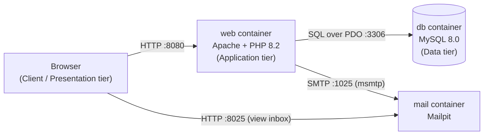

# Containerized Client–Server Application

**Name:** Shem Chawe
**Registration No:** BSCSF/M/0170/01/25
**Unit:** Distributed Systems  
**Activity 3:** Design and implement a simple client–server application on localhost

## 1. Overview

This project is a simple client–server application that runs entirely on `localhost`. Users can register an account, log in, save contact details, search for a contact by registration number, and reset a forgotten password by email. Each part of the system runs in its own Docker container, and Docker Compose starts them together.

## 2. Architecture



### Layers

| Layer | Component | What it does |
|---|---|---|
| Presentation (client) | Web browser | Shows the HTML forms and pages, and sends requests to the server |
| Application (server) | `web` container: Apache + PHP | Handles requests, validates input, hashes passwords, manages sessions, creates reset tokens, and talks to the database and mail service |
| Data | `db` container: MySQL 8.0 | Stores the `users` and `contacts` tables |
| Supporting service | `mail` container: Mailpit | Receives and displays the password-reset emails (a test mail server; no real email is sent) |

The layers are separated at the container level. The browser never talks to the database directly. All data goes through the PHP application tier.

## 3. How the components communicate

| Feature | Client → Server | Server → other services |
|---|---|---|
| Register / login (`register.php`, `index.php`) | Browser sends a POST with username and password | PHP queries `users` in MySQL and checks the password hash |
| Save a contact (`dashboard.php`) | Browser sends a POST with the contact details | PHP inserts a row into `contacts` in MySQL |
| Search a contact (`search.php`) | Browser sends a POST with a registration number | PHP runs a SELECT on MySQL and returns the matching row as HTML |
| Password reset (`forgot-password.php`, `reset-password.php`) | Browser sends the user's email, then later the new password | PHP stores a reset token in MySQL and sends an email through Mailpit |

Containers find each other by service name on the Docker Compose network (for example, PHP connects to the host `db` and the mail server `mail`).

## 4. Project files

- `Dockerfile` builds the PHP 8.2 / Apache image with MySQL support and `msmtp` for sending mail.
- `docker-compose.yml` defines the `web`, `db` and `mail` services.
- `init.sql` creates the `contact_db` database and the `users` and `contacts` tables.
- `index.php`, `register.php`, `dashboard.php`, `search.php`, `forgot-password.php`, `reset-password.php`, `logout.php` are the application pages.
- `msmtprc` routes PHP's outgoing mail to the Mailpit container.

## 5. How to run

Install Docker Desktop, start it, then run these commands in the project folder:

```powershell
docker compose up --build -d
docker compose ps
```

Open:
- Application: http://localhost:8080/register.php
- Mailpit inbox: http://localhost:8025

To stop it, run `docker compose down`.

## 6. Evidence

**Containers running**


**Registration, login and dashboard**


**Contact saved (browser → PHP → MySQL)**


**Search result (data read back from MySQL)**


**Password-reset email received in Mailpit (PHP → mail service)**


**Password updated**


**Saved row checked directly in the database**


**Browser request to the server (Network tab)**


## 7. Notes

- The database password in this project is for local classroom use only and should be changed before any real deployment.
- Mailpit only captures test emails locally. It does not deliver them to real mailboxes.
- The application logic is written in PHP pages that also contain their HTML. A larger version could separate the presentation, business logic and database code into separate files.
